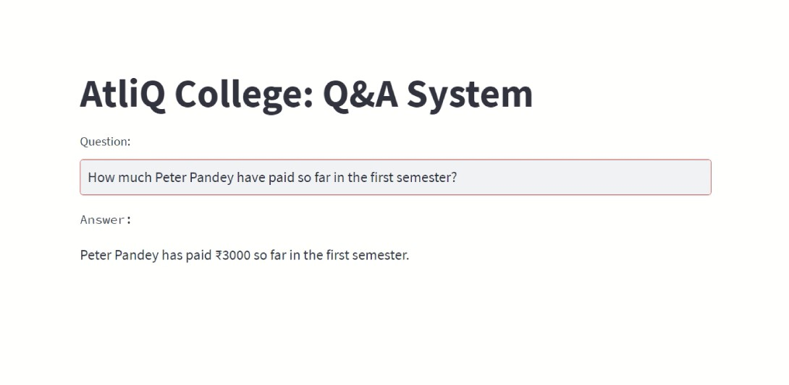

# College Q&A with OpenAI tool calling

[](https://github.com/HoussemEddineWeslati/OpenAI-Function-Calling/actions/workflows/ci.yml)

A question-answering assistant for an imaginary college. It answers questions about students'
marks and fees from a MySQL database, and general questions from the model's own knowledge.
The model never touches the database directly: it **proposes** a tool call, and the application
validates and runs it.



## How it works

1. The question goes to the model with two tools, `get_marks` and `get_fees`, described as JSON schemas.
2. If the model needs data, it returns a tool call instead of text.
3. The application **parses and validates** the arguments (semester 1–4, allowed operations and fee types)
   before anything reaches the database. Invalid arguments are sent back to the model as an error it can correct.
4. The result goes back to the model, which writes the final answer. A missing record is reported as
   "no matching record" instead of a misleading number.
5. The loop is capped at three tool rounds, so a confused model can never loop forever.

```text
question → model ──tool call──▶ validate ──▶ stored procedure (MySQL)
               ◀── result / error ───────────┘
          → final answer
```

## Example questions

- *How much does Peter Pandey still owe in the first semester?* → `get_fees`, pending fees
- *What was the average GPA in the third semester?* → `get_marks`, aggregate
- *What is the purpose of a balance sheet?* → answered directly, no tool call

## Project structure

```text
college_qa/
  tools.py       tool schemas, argument validation, safe dispatch
  assistant.py   the tool-calling loop (OpenAI Python SDK, tools API)
  db.py          MySQL access through stored procedures, configured by environment variables
app.py           Streamlit interface
db/              database schema, sample data and stored procedures
tests/           unit and property-based tests
```

## Tests

The model is replaced by a scripted fake client, so the tests run without an API key or a database.
They cover the full tool-calling loop, argument validation, error reporting and the round limit.
Two **property-based tests** (Hypothesis) check invariants over generated inputs:

- whatever text the model sends as arguments, the dispatcher returns valid JSON and never crashes;
- the database only ever receives a semester between 1 and 4 and an allowed fee type.

```bash
pip install -r requirements-dev.txt
pytest
```

## Running it

```bash
pip install -r requirements.txt
cp .env.example .env        # add your OPENAI_API_KEY and database settings
# load db/atliq_college_db.sql into MySQL
streamlit run app.py
```

## Credits

This project started from the AtliQ College example of the
[codebasics](https://www.youtube.com/@codebasics) course on OpenAI function calling. I rebuilt it on
the current OpenAI tools API, added argument validation and error handling, configuration through
environment variables, a test suite with property-based tests, and continuous integration.

**Houssem Eddine Weslati** · [houssemweslati.com](https://houssemweslati.com)
